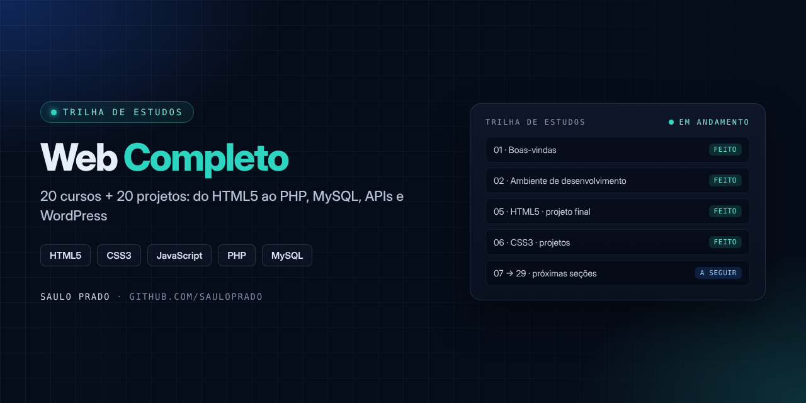
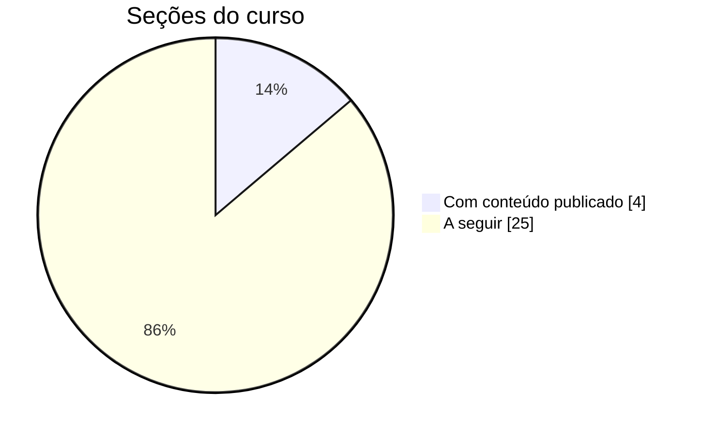

<p align="center">

</p>

<h1 align="center">Desenvolvimento Web Completo</h1>
<p align="center"><i>Trilha de evolução no curso 20 cursos + 20 projetos, com publicação incremental</i></p>

<p align="center">


</p>

## Sumário

- [Sobre o curso](#sobre-o-curso)
- [Progresso](#progresso)
- [Projetos práticos](#projetos-práticos)
- [Como navegar](#como-navegar)
- [Padrão de commits](#padrão-de-commits)
- [Estrutura do repositório](#estrutura-do-repositório)
- [Autor](#autor)

## Sobre o curso

Repositório que centraliza a jornada no curso **Desenvolvimento Web Completo — 20 cursos + 20 projetos** (Jorge Sant Ana e Jamilton Damasceno), com foco em **evolução contínua** e **histórico auditável** do aprendizado.

| | |
| --- | --- |
| **Conteúdo** | 29 seções · 645 aulas · 120h 09m |
| **Stack** | HTML5, CSS3, Bootstrap 4, SASS, JavaScript, ES6/OO, PHP, MySQL, Ajax, jQuery, MVC, APIs (Slim), Ionic, WordPress e Git |

## Progresso



| Seção | Status |
| --- | --- |
| 01 · Boas-vindas | ✅ |
| 02 · Ambiente de desenvolvimento | ✅ |
| 05 · HTML5 | ✅ projeto final |
| 06 · CSS3 | ✅ 2 projetos |
| 03, 04 e 07 → 29 | 🔜 estrutura criada |

## Projetos práticos

| Projeto | Seção | Páginas |
| --- | --- | --- |
| [Projeto Final HTML](05-html5/ProjetoFinalhtml/) | 05 · HTML5 | `index`, `quem-somos`, `contato` |
| [Projeto Anna Bella](06-css3/ProjetoAnna%20Bella/) | 06 · CSS3 | `index`, `bio`, `campanha`, `contato` |
| [Projeto Caixa](06-css3/ProjetoCaixa/) | 06 · CSS3 | modelo de caixa (box model) |

## Como navegar

- Cada seção do curso tem uma pasta numerada (`01-...` a `29-...`)
- Projetos práticos ficam dentro da seção ou em `projetos/`
- Marcos ficam registrados no [CHANGELOG.md](CHANGELOG.md) e comandos úteis no [COMMANDS.md](COMMANDS.md)

Para ver um projeto, abra o `index.html` da pasta no navegador.

## Padrão de commits

| Tipo | Exemplo |
| --- | --- |
| `docs` | `docs: adiciona anotações da seção 05 (HTML5)` |
| `feat` | `feat: adiciona projeto 01 (landing page)` |
| `refactor` | `refactor: melhora responsividade do projeto 02` |
| `fix` | `fix: corrige validação de formulário no projeto 03` |

## Estrutura do repositório

```text
fullstack-web-20cursos-20projetos/
├── 01-boas-vindas/ … 29-conteudos-bonus/
├── 05-html5/ProjetoFinalhtml/
├── 06-css3/
│   ├── ProjetoAnna Bella/
│   └── ProjetoCaixa/
├── projetos/projeto-01 … projeto-20/
├── assets/capa.png
├── CHANGELOG.md
└── COMMANDS.md
```

## Autor

**Saulo Prado** · Analista de Sistemas · Gestão de Ativos de TI, orçamento, automação e dashboards

[](https://www.linkedin.com/in/saulo-prado-ab4a0b96/)
[](https://github.com/sauloprado)
